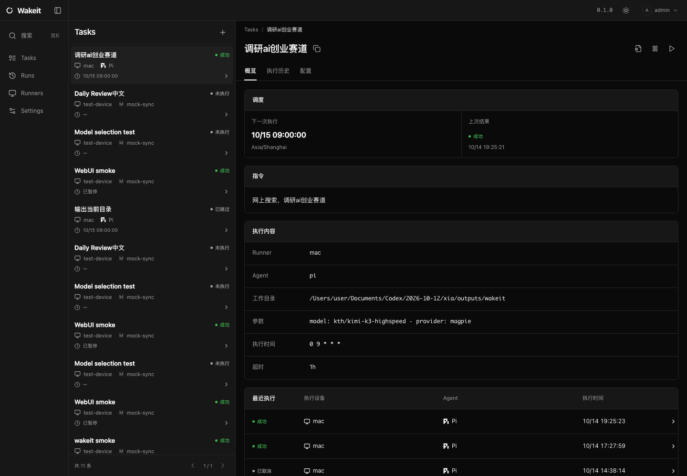

# Wakeit

让 Agent 在指定时间、指定设备上完成任务。

你定义指令和时间，Wakeit 将任务交给设备上的 Runner。Gateway 集中管理调度、成员和执行记录；WebUI 展示过程、日志和结果。



- **接入已有 Agent**：内置 Codex、Claude Code、Pi、OpenCode；自定义适配只需配置命令。
- **在自己的设备执行**：Runner 主动连接 Gateway，支持 Linux、macOS、Windows，无需设备开放入站端口。
- **按时运行，查看结果**：Cron、固定间隔、一次性时间和手动执行；支持实时过程及 Markdown 报告，包含代码高亮、公式与 Mermaid 图表；Moments 首页按完成时间汇总结果。
- **保留执行上下文**：任务可绑定原生会话，完成后在 Runner 设备用 `wakeit run resume <run-id>` 继续交互；见 [会话续聊](docs/cli.md#绑定会话与本机续聊)。
- **本地或云端托管**：一个 Rust 二进制包含 Gateway、Runner 和 CLI，WebUI 随 Gateway 交付。

当前为 **0.1.0 预览版**，使用 Apache-2.0 许可。接口与数据结构仍可能调整。

## 安装与接入

从 [v0.1.0 Release](https://github.com/mob999/wakeit/releases/tag/v0.1.0) 下载当前系统和架构的二进制，同时下载 `wakeit-release.json` 与 `SHA256SUMS`，核对 SHA-256 后安装到用户 bin 目录。支持 Linux、macOS 和 Windows。

已有 Gateway 时，可直接点击 WebUI 顶栏的 `{}` 复制 Prompt，交给 Agent 完成 CLI 安装、浏览器授权、设备注册和用户自启；你只需在浏览器核对并授权。

```sh
wakeit setup --gateway https://wakeit.example.com
# 可选：--runner-name dev-server --allow-root /path/to/projects
wakeit connection list
wakeit runner list
```

默认设备名是主机名，执行范围是当前工作目录。Admin、Operator 可注册 Runner，只有 Admin 可吊销。已安装并登录的 Agent 保持原样，setup 不会替你创建或运行任务。

只需 CLI 时使用 `wakeit login --gateway URL`，Viewer 同样可用。连接按 Gateway 保存在平台标准配置目录，跨目录生效；API Key 默认不过期，可在 Settings → API Key 撤销。`wakeit connection use NAME` 切换已有连接。显式参数和 WAKEIT 环境变量仍可使用。

从源码构建需要 Rust 1.89+、Node.js 22.12+：

```sh
git clone https://github.com/mob999/wakeit.git
cd wakeit
npm --prefix web ci
npm --prefix web run build
cargo install --locked --path crates/wakeit
```

管理员可在 Settings → 成员中创建账号、调整角色、启停账号和重置密码，也可使用邀请链接。停用或重置密码会撤销该账号全部登录和 API Key。

## 自行部署 Gateway

单机部署需要 Docker Compose v2。在仓库根目录执行：

```sh
cp .env.example .env
# 修改 .env 中的 WAKEIT_POSTGRES_PASSWORD
docker compose build
docker compose up -d
export WAKEIT_PASSWORD='至少 12 字节的管理员密码'
docker compose run --rm -e WAKEIT_PASSWORD gateway \
  gateway bootstrap --config /app/gateway.yaml --username admin
unset WAKEIT_PASSWORD
```

打开 <http://localhost:8080> 登录。Compose 会持久化 PostgreSQL、NATS 数据并自动重启服务；Linux 还需启用 Docker 的系统自启。

macOS、Windows 的 Docker Desktop 登录启动不能代替无人登录时的系统启动。需要三平台开机运行时，使用 [系统级原生部署](docs/gateway-service.md)。跨设备部署同时配置 Gateway 的公开地址及 NATS HTTPS/WSS 地址，见 [部署与运维](docs/operations.md)。

## 注册设备，创建首个任务

在设备上安装并登录需要使用的 Agent，再运行 `wakeit setup --gateway URL`。用户自启安装后可关闭当前终端。执行范围由 `--allow-root` 指定，未配置范围时不能浏览目录或执行任务。手动注册及自启方式见 [Runner 指南](skills/wakeit/references/runner.md)。

在 WebUI 新建任务：填写名称和指令，选择 Runner、目录、Agent 与模型，再进入“时间”页设置调度并保存。

CLI 可导入 [任务示例](examples/task.yaml)。修改示例中的设备、目录和指令后：

```sh
wakeit task apply --file examples/task.yaml
wakeit --json task trigger daily-review
wakeit run logs <run-id> --follow
wakeit task pause daily-review
```

Task 的权威存储是 Gateway 的 PostgreSQL；YAML 是提交或更新任务的输入文件。模型发现取决于适配提供的接口，没有接口时手填。任务失败不会自动重新执行；无法确认执行结果时进入 `unknown`，先核对，再决定是否重试。

任务可在详情中归档，正在执行的 Run 继续，历史保留；Settings → 归档任务可恢复，恢复后保持暂停。CLI 对应命令为 `wakeit task archive <id>`、`wakeit task list --archived` 和 `wakeit task restore <id>`。

## 让 Agent 帮你使用 Wakeit

仓库提供可独立安装的 [Wakeit skill](skills/wakeit/SKILL.md)。将整个 `skills/wakeit` 目录安装到所用 Agent 的技能目录，再调用 `$wakeit`：

> 使用已有 Gateway，注册这台设备，并创建每天早上九点检查仓库的任务。

Skill 按需加载连接、部署、Runner、任务、运行、适配器和更新指南，不会把“连接已有服务”误当成“部署新服务”。安装方式见 [Skill 使用说明](docs/skills.md)。

## 更新

```sh
wakeit update --check
wakeit update
```

通过公开 GitHub Releases 检查正式版本，无需 GitHub 登录。普通更新排除预览版；只有 v0.1.0 预览发布时会返回“暂无正式发布”，同版本提交不会触发更新。校验通过后只替换二进制，不改数据和配置，也不自动重启运行中的服务。

## 文档

| 需要做什么 | 文档 |
|---|---|
| 使用 CLI 管理任务和运行 | [CLI 指南](docs/cli.md) |
| 配置开机自启 | [Gateway 系统服务](docs/gateway-service.md) |
| 部署、备份、恢复和升级 | [部署与运维](docs/operations.md) |
| 开发 Agent 适配 | [配置与适配协议](docs/protocol.md) |
| 调用接口 | [REST API](docs/api.md) |
| 构建和运行测试 | [开发指南](CONTRIBUTING.md) |

许可证：[Apache-2.0](LICENSE)。第三方技能及 Windows 服务工具的来源见 [第三方组件](docs/third-party.md)。
