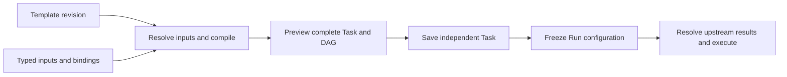

# RFC-2: Task templates with MiniJinja and generated DAGs

Status: accepted. RFC tracking issue: [#138](https://github.com/mob999/wakeit/issues/138); implementation issue: [#142](https://github.com/mob999/wakeit/issues/142). The published 0.3.3 release does not include the implementation or change its schema baseline.

## Product model

A workspace Task Template is a reusable task recipe with declared business inputs and execution-environment bindings. Using it means selecting a template revision, filling inputs, reviewing the complete generated task, then choosing **Create task / 创建任务** or **Create & run / 创建并执行**. Both actions create a visible, independent Task. Create & run additionally creates one Run atomically.

Support ordinary Tasks and **creation-time dynamic DAGs** in the first implementation. A repository list can generate one review node per repository, conditions can include or omit nodes and references, and a final node can depend on the entire generated group. The compiler saves a complete executable TaskConfig: scheduling and execution never need the template engine.

Template edits affect future instantiations. Existing Tasks do not inherit edits, silently regenerate, or run against the latest template. An existing Task can be saved as a new template. Template archive prevents new instantiations and preserves existing Tasks and Runs. There is no hidden temporary Task, template marketplace, automatic repository clone, or runtime graph expansion in this proposal.

Template inputs are separate from `TaskConfig.parameters`, which remains the existing string-valued Agent adapter parameters. Repository URLs, lists and application options must not be inserted into that map. Credentials remain in the existing Runner/Agent configuration. Templates do not capture Agent credentials or existing Session IDs; generated tasks start with a fresh session.



## Inputs, defaults and overrides

`inputs` declares a closed, JSON-compatible schema. Support string, boolean, integer, number, array and object; string formats include multiline text, directory and repository URL. Arrays declare `items`; objects declare `properties` and `required`. Support typed enums, nullable types, labels/descriptions, top-level input defaults, numeric bounds, string lengths and list lengths. Reject unknown schema keywords and unknown value properties rather than silently discarding them. Do not advertise arbitrary JSON Schema or external `$ref` support.

Repository URLs accept supported HTTP(S), SSH and SCP-style Git addresses. A local working directory is a separate directory input. Validate every generated node's effective directory against its assigned Runner's path rules; a shared input does not make a path portable between devices. Merely saving a template does not probe remote repositories or execute commands.

Preview and instantiate receive the same override document:

```json
{
  "values": {
    "repositories": [
      { "key": "wakeit", "url": "https://github.com/mob999/wakeit" }
    ],
    "include_diff": false
  },
  "unset": ["since"]
}
```

| Input state | Resolution |
|---|---|
| Absent from both `values` and `unset` | Use its declared default, if any |
| Present in `values` | Replace the entire top-level value |
| Named in `unset` | Omit it and suppress its default |
| Present in both, or an unknown key | Field error |

`false`, `0`, `""`, `[]`, `{}` and a permitted `null` are actual values. Arrays and objects replace the default as a whole; do not deep-merge objects or refill missing nested properties. First-version defaults apply only to top-level inputs; reject nested schema defaults. Array order is significant. Required and nonempty are distinct constraints. Unsetting a required input returns a field error.

The form keeps the original override document separately from resolved values. Restore default removes both the override and the unset marker. Clearing a text/list control produces an empty value; clearing an optional numeric/enum control can unset it. Never turn an empty numeric draft into zero or immediately restore a cleared default. JSON/YAML modes edit this same `values`/`unset` document, preserving explicit omission.

## Rendering contract

Use [MiniJinja](https://docs.rs/minijinja/latest/minijinja/) for text rendering and typed expressions. Pin a dependency compatible with the repository's Rust MSRV when implementing; this RFC adds no dependency. The implementation's language profile is fixed by template format version 1.

- Use `[[ expression ]]` for text interpolation, `` and `` for blocks, and `{# ... #}` for comments. MiniJinja supports [custom delimiters](https://docs.rs/minijinja/latest/minijinja/syntax/struct.SyntaxConfig.html); the different interpolation marker distinguishes template inputs from legacy DAG result syntax.
- Support nested text conditions/loops, comparisons, boolean operations, local variables, local macros and pure value filters, including `default`, `join`, `length` and `tojson`. Lists/objects intended as JSON use explicit `tojson`; prose lists normally use `for`.
- Typed expressions use `{expr: "..."}` with `compile_expression`, without interpolation delimiters. Require the declared return type, including a real boolean for `when`; the string `"false"` is not a boolean.
- Use [strict undefined handling](https://docs.rs/minijinja/latest/minijinja/enum.UndefinedBehavior.html). Optional branches use `is defined` or explicit `default`; do not silently substitute empty text for a typo.
- Text is plain text, without HTML autoescaping. Preserve source whitespace and trailing newlines by default; authors may use MiniJinja whitespace controls.
- Supply only resolved `inputs`, and the current item alias for an expanded node. No filesystem loader, cross-template include/import/inheritance, process environment, clock, network or shell functions. Existing Agent command templates keep their current renderer and semantics.
- Configure rendering fuel/recursion and output protection using [Environment controls](https://docs.rs/minijinja/latest/minijinja/struct.Environment.html), calibrated against supported configurations and realistic examples. Fail with a field/template error **before creating a Task or Run**. Do not add arbitrary small list limits or apply template-rendering budgets to an executing Agent.

Only explicitly marked fields execute MiniJinja. A template-capable field is `string | {template: string}`; a plain string remains literal even if it contains template syntax. Allow this form for Task names, node names, working directories and instruction text. Runner, Agent and adapter parameters come from explicit binding slots, not arbitrary text substitution. Do not recursively interpret `{template: ...}` inside user objects, or render a complete YAML document and parse its output as configuration.

Binding slots have stable names, display labels and optional Runner/Agent/parameter defaults. An ordinary Task or DAG node selects a slot with `binding`. Instantiation supplies the chosen Runner, Agent and adapter parameters for each used slot. Resolve and validate them with existing workspace rules, then remove blueprint-only binding fields. A directory input used by `cwd` and instructions has one control; the effective directory is shown in the final preview. Directory browsing always identifies the Runner being browsed. If several assigned Runners could be used, ask the user to choose one in that picker; never silently choose the first slot. The final directories must still validate for every actual node, so templates needing different device paths expose separate inputs. Only binding slots used by generated nodes are required; input changes can activate additional slots and invalidate the prior preview. Saving from a Task can prefill its environment but must not assume a copied device identity is usable in another workspace.

## Creation-time DAG construction

The blueprint contains fixed node declarations and named expansion groups. Fixed declarations have a literal `id`; an expansion has `group`, `for_each`, `as`, `key` and `node`. Names are static and share one declaration namespace.

`for_each.expr` returns an ordered array of objects. `key` names a string property on every item; it is mandatory, unique within the group and stable across list insertion/reordering. Validate all keys before filtering items. Generate IDs as `<group>__<key>`, validate the existing ID format/length and whole-graph uniqueness, and never truncate or append an index to hide a collision. Changing a key changes node identity. Simple string lists remain supported as inputs and in text loops; node expansion uses keyed object lists.

`when` on a fixed declaration reads `inputs`. On an expansion declaration it is evaluated per item with `inputs` and its `as` alias. The alias cannot shadow reserved context names. A conditional `for_each` expression can gate a whole group. Structural expressions cannot read another group's expansion, execution state or results. First version supports one level of named expansion groups; nested objects and nested text loops remain available.

Use typed references rather than constructing dependency IDs in strings:

```yaml
{node: summarize}
{group: review, key: wakeit}
{group: review, key: {expr: repo.key}}
{group: review, all: true}
```

These selectors can be used in `pre`, `dag.results` and instruction result parts. A selector may have `when: {expr: ...}` using the owning node's input/item scope, or inputs only for output selection. Declaration names are literal and checked statically, including in disabled selectors. Then evaluate the selector condition first: false skips its key expression, actual target lookup and any separator insertion. This allows a condition to guard optional input access. A keyed selector must resolve to an actual generated node; missing or conditionally omitted targets are errors. `all` for a declared but empty group expands to an empty list. An unknown group is always an error.

The following is a **template blueprint**, not a TaskConfig accepted by the current release:

```yaml
version: 1
id: repository-monitor
name: 仓库提交监控
inputs:
  type: object
  additionalProperties: false
  required: [repositories, working_directory]
  properties:
    repositories:
      type: array
      items:
        type: object
        additionalProperties: false
        required: [key, url]
        properties:
          key: {type: string, minLength: 1}
          url: {type: string, format: repository-url}
          enabled: {type: boolean}
    working_directory: {type: string, format: directory}
    include_diff: {type: boolean, default: false}
    include_summary: {type: boolean, default: true}
    language: {type: string, enum: [zh, en], default: zh}
bindings:
  worker: {title: 检查环境}
task:
  name: {template: "仓库监控 · [[ inputs.repositories | length ]] 个仓库"}
  schedule: null
  dag:
    nodes:
      - group: review
        for_each: {expr: inputs.repositories}
        as: repo
        key: key
        when: {expr: "repo.enabled | default(true)"}
        node:
          binding: worker
          name: {template: "检查 [[ repo.key ]]"}
          cwd: {template: "[[ inputs.working_directory ]]"}
          prompt:
            parts:
              - template: |-
                  检查仓库 [[ repo.url ]] 的新增提交，报告中保留仓库名称和地址。
                  包含关键差异及证据链接。
                  按 [[ inputs.language ]] 输出。
      - id: summarize
        when: {expr: inputs.include_summary}
        binding: worker
        name: 汇总
        cwd: {template: "[[ inputs.working_directory ]]"}
        pre:
          - {group: review, all: true}
        prompt:
          parts:
            - template: |-
                汇总以下实际生成的仓库报告，按 [[ inputs.language ]] 输出。
                
                - [[ repo.key ]]: [[ repo.url ]]
                
                若没有生成任何检查报告，明确说明没有启用的仓库。
            - result: {group: review, all: true}
              separator: "\n\n"
    results:
      - {node: summarize, when: {expr: inputs.include_summary}}
      - {group: review, all: true, when: {expr: "not inputs.include_summary"}}
```

Two enabled repositories with keys `wakeit` and `docs` generate `review__wakeit`, `review__docs`, and optionally `summarize`. Its predecessors become the two concrete IDs. Each declaration expands at its position, preserving input list order. This is presentation order, not execution order: roots remain concurrent and only `pre` establishes AND dependencies. Explicit output selectors choose reports; report ordering continues to follow final `dag.nodes`, not selector order.

An omitted conditional node does not exist and has no Run, skipped state or result. Do not remove dangling keyed dependencies, connect around missing nodes, or replace their results with empty strings. Authors condition the reference/consumer too, or intentionally use `all`.

Empty groups are allowed. A consumer of an empty `all` dependency has no predecessors and is a root; preview it that way. The final DAG must contain at least one node. Explicit `dag.results` must expand to a nonempty, unique set of existing nodes. Omitted results retain existing leaf selection. Never silently fall back from invalid explicit outputs or convert an empty DAG into an ordinary Task.

## Instruction parts and runtime references

Different interpolation markers alone do not prevent a second interpretation: today's DAG renderer scans the final string for `{{ nodes.<id>.result }}`. A user value containing that text must not introduce a new upstream reference.

An ordinary blueprint prompt uses the literal-string/explicit-template field form. A DAG blueprint prompt always uses `parts`, with typed parts: `{text: literal}`, `{template: MiniJinja source}`, or `{result: selector, separator?: literal}`. Each template part is independently compiled; blocks must close inside that part. A group result selector expands to concrete result parts separated by the declared literal text. Repeated explicit result references retain their order.

The final Task's node prompt accepts:

```text
Prompt = Legacy(String) | Structured { parts: [Text | Result] }
Text   = { text: String }
Result = { result: concrete_node_id }
```

Only template blueprints accept `template` parts. The final Task schema rejects any remaining `template`, `expr`, `when` or generator fields in their configuration positions. Input objects containing these property names are ordinary data, not executable wrappers.

Rendered template parts become literal text once. Text is never scanned for MiniJinja or legacy DAG syntax. Only result parts read actual ancestor outputs from the same Run. Upstream output is also inserted verbatim without recursive interpretation. Missing, expired, incomplete or truncated required outputs keep the existing execution-time failure semantics and actual execution-source snapshots.

Update reference enumeration, expansion, input provenance and retry checks together. Initial dispatch, automatic retry and manual node recovery must use one prompt abstraction; never flatten structured parts and feed them to the legacy parser. `Node::execution` still receives a final string, so an old Runner continues to receive an ordinary version-1 execution payload.

Old string prompts and historical snapshots remain unchanged. Exported Tasks retain structured parts; an assembled reading preview is not a round-trip export. New CLI/Gateway versions read old configurations; old CLI/Gateway versions are not guaranteed to understand the new structured prompt form. Runner compatibility and config/message `version: 1` are retained. Before enabling writes of structured prompts, upgrade every Gateway that may schedule or recover those Tasks/Runs. Plan a coordinated Gateway upgrade/write pause; mixed old/new Gateway writes are not claimed to be compatible. Runners need not be upgraded for this payload change.

Saving an ordinary Task as a template preserves strings literally. For an existing structured DAG prompt, copy text bytes and map each final `{result: "id"}` to the blueprint selector `{result: {node: "id"}}`, preserving part order. Convert a legacy DAG prompt using the existing segment parser into literal text and concrete result selectors, preserving whitespace, repeated references and order. Do not treat the whole legacy prompt as literal, which would lose references, or as template source, which would execute examples. Do not infer inputs or reconstruct a lost generator from an already expanded Task. Users explicitly parameterize fields afterwards. Drop the original Task ID, execution history and Session binding.

## Compiler, persistence and concurrency

Saving a template validates its declaration/schema and all template/expression syntax without requiring business values or live binding selections. A declaration may therefore be valid while a particular input produces an invalid graph; instantiate-time validation remains mandatory.

Preview and instantiate use the same deterministic compiler:

1. Validate the template schema and compile all declared template/expression syntax.
2. Resolve defaults, whole-value overrides and explicit unsets, then validate typed values.
3. Register fixed/group declarations; evaluate each list, validate stable keys, apply conditions and record every generated identity and its source input path.
4. Render retained field/part templates. Register all actual nodes before resolving typed dependency, result and output selectors, allowing forward declaration references.
5. Expand selectors and result separators. Run complete Task/DAG validation: duplicate IDs/predecessors/outputs, missing targets, self-dependencies, cycles, result ancestry, nonempty graph/output selection and existing configuration limits.
6. Resolve used execution bindings and existing Runner/Agent/parameter/directory/session rules. Produce the final config, resolved inputs and a source map for field errors and graph preview.

Numbers remain native JSON numbers without lossy UI coercion; reject unrepresentable values rather than rounding. Preserve array order. Object iteration must use a deterministic key order; use `dictsort` when order matters. No Task, Run, event or Outbox entry is created by a compile/validation failure.

Add workspace-scoped template storage with definition, revision, editor layout where applicable, creator/updater, timestamps and `archived_at`. Persist instance origin separately from TaskConfig: template ID/name/revision, original `values`/`unset`, resolved inputs, resolved bindings, and group/key-to-node mapping. This metadata describes creation-time values, not the current hand-edited Task. Freeze the relevant origin alongside each new Run's configuration.

Append migrations for template resources, instance origin and operation idempotency; never edit published migrations. Structured prompts themselves fit the existing JSONB snapshot chain and do not require rewriting old records. Keep product 0.3.3 and configuration/message version 1 during implementation unless a separate release is explicitly requested.

After authorization and canonical request hashing, first look for an already committed idempotent operation. Return an authorized matching result before reading, recompiling or checking the current template revision/archive state; a lost response must remain replayable after template changes. A mismatched payload is a conflict. Only a miss proceeds to read/compile the template.

Rendering happens outside a write transaction. Inside one transaction, recheck idempotency, workspace membership/permission, template revision/archive state and binding validity; reserve the Task ID; create the Task/origin, optional Run/DAG seed, audit/event/Outbox entries, and idempotency result. Refactor transaction-aware helpers from existing apply/trigger paths instead of composing their separately committed public functions. Follow the existing workspace-first lock order, with template/operation/Task locks in a consistent order across writers.

Idempotency is scoped to workspace, actor, operation and key, with a canonical business-request hash; exclude preview-only correlation metadata. An identical retry returns the same Task/Run IDs, including after a lost response. A reused key with a different payload returns 409. Reauthorize before replaying a stored result; an authorized replay does not create another instance or reinterpret a subsequently edited template. A new request with a stale template revision returns 409. Creating a conflicting explicit Task ID never overwrites an existing Task.

Default to manual scheduling. Create & run with a repeating schedule computes the next scheduled time strictly after now. For a one-time schedule already due, consume that due time in the same transaction so it cannot create a second immediate Run. A future one-time schedule plus run-now means one execution now and one at the chosen future time; show both in the Time step. Reuse existing overlap, permission and dispatch rules.

The saved Task is the scheduling authority. Template or input changes do not alter it. A Run freezes the current compiled Task; node retry/recovery uses that Run's frozen graph and preserves successful nodes. Existing whole-graph rerun creates a new Run from the **current Task**, including any explicit edits; it still does not read or re-render the template.

First version provides creating new instances and normal Task editing. An existing Task's origin does not provide live inheritance or a hidden "update from template" operation. Regenerating into an existing Task, if added later, must be explicit, preview the complete replacement/diff and use both Task and template revision guards; it must not merge a generated graph into hand-edited nodes silently.

## Workspace API and CLI

These are proposed workspace-scoped routes under `/api/v1/workspaces/{workspace}`; existing `/agents/templates/{id}` remains the built-in Agent-adapter template endpoint.

| Method and route | Purpose | Minimum role |
|---|---|---|
| GET `/task-templates` | Paginated/searchable template list | Viewer |
| GET `/task-templates/{id}` | Definition and revision | Viewer |
| PUT `/task-templates/{id}` | Create/update with expected revision | Operator |
| POST `/task-templates/{id}/archive` or `/restore` | Change template availability | Operator |
| POST `/task-templates/{id}/preview` | Resolve current inputs and show final config/graph | Viewer |
| POST `/task-templates/{id}/instantiate` | Atomic create or create-and-run | Operator |

Preview accepts `expected_revision`, `values`, `unset`, named `bindings`, optional `task_id`/literal name override, schedule choices and `run_now`. A preview also carries a client request identifier, echoed in its response. Omitted Task ID gets a server-generated identity; the preview may show a provisional ID, but idempotency reserves the actual instance identity only at commit. Preview returns the template revision, resolved inputs, final config when valid, generated source map and structured issues. A successfully generated graph can still be shown with binding errors; it is not yet a valid final config. Runtime result slots stay visible as references; preview never invents upstream output. Instantiate recompiles the same request and rechecks the guarded revision; client preview output is not trusted as saved config.

Instantiate requires `Idempotency-Key` and returns `{task_id, task_revision, run_id: null | UUID, template_revision}`. Syntax, input, graph and binding issues have distinct error codes, stable logical paths such as `inputs.repositories[2].url`, a blueprint/node/part path when relevant, and template line/column where available. Validate selectors and report their originating input/group/key instead of only a generated ID. Follow the current API's validation response conventions and reserve 409 for revision, idempotency or identity conflicts.

```bash
wakeit template list
wakeit template get repository-monitor
wakeit template apply --file repository-monitor.yaml
wakeit template preview repository-monitor --inputs-file values.yaml --bindings-file bindings.yaml
wakeit task create --template repository-monitor --inputs-file values.yaml --bindings-file bindings.yaml
wakeit task create --template repository-monitor --inputs-file values.yaml --bindings-file bindings.yaml --run
```

`--inputs-file` contains the shared `values`/`unset` document; JSON and YAML preserve typed lists and objects. CLI uses the server compiler, carries the selected template revision and reuses an idempotency key across a transport retry. Do not claim new CLI behavior in current released CLI documentation until implementation lands.

## WebUI and i18n

Keep the existing primary navigation. Add **From template / 从模板创建** to Tasks creation, and **Save as template / 保存为模板** to a Task's menu. A compact template chooser shows name, ordinary/DAG type, input count and description; template management is reachable from its toolbar. Keep Task / Time steps and current table-card styling: 1px border, 6px corners, 44px header, 12px text, 11px secondary text, transparent 28px icon controls.

Use one frame with roughly one-third input controls and two-thirds final preview; stack on narrow screens. Arrays use compact rows, add/remove and drag handles with keyboard move-up/down. Objects expand within the same table rather than nested cards. Stable UI row identities preserve focus, drafts and errors across reordering; map server index paths to the current item. Booleans/enums use typed choices, with Unset for optional values and explicit null only where permitted.

Form / JSON / YAML share one typed override state. Parsing errors keep the editor draft and location. Unknown fields or incorrect types are preserved with errors, not "normalized" away. YAML is a single JSON-compatible document with duplicate keys and ambiguous non-JSON values rejected; comments/formatting need not round-trip, values and ordering do.

Template authors use a compact **Text / Template · 文本 / 模板** field control plus Insert input and condition/loop snippets. Switching modes retains source drafts; literal mode does not execute syntax. For a structured instruction, this switch applies only to the selected text part: keep result-reference parts and their order intact, and require blocks to close within their own template part. Never flatten the entire prompt to implement a mode change. Keep actual wrappers in raw export, not in everyday product labels. Dynamic declaration authoring uses a schema-assisted blueprint YAML/JSON editor alongside the generated read-only graph; this is distinct from JSON/YAML input-value editing. Do not introduce a block-programming UI.

For dynamic DAGs, the preview shows the actual generated graph/table and selected node instructions, plus the generated node/output counts. Reuse graph/table switching, search and node selection; keep input values visible while switching nodes. Show conditions' effects in the actual generated structure, with per-node source mapping available for locating an error. Do not depict a filtered node as a runtime skipped node. Mark the previous preview stale immediately after any change and disable final submit until current validation succeeds. Retaining a prior successful preview must not make it appear current. Bind every request to the complete draft/revision/binding/options signature and the current array-row identity snapshot. Apply a response only if it is the latest matching draft version; stale or out-of-order responses cannot enable submit, replace current validation or attach an old array index to a reordered item. Keep drafts and field issues through failed previews.

Use `taskTemplate.*` translation keys for controls and distinct validation messages. User-defined labels, prompts, enum titles and input values are not automatically translated. Cover Chinese/English, light/dark, keyboard interaction and 390/1024/1440px layouts. No new execution-page controls or runtime semantic changes are needed.

## Implementation sequence and acceptance

Deliver the following in dependency order, with scoped implementation issues and PRs after this RFC is accepted:

1. **Prompt compatibility.** Add the final legacy/structured prompt union, one reference/expansion/provenance path, schema/editor/export support and legacy-to-parts conversion. Verify ordinary payloads and old Runner compatibility, including node retry/recovery and literal marker inputs.
2. **Pure template compiler.** Add schema/override resolution, explicit literal/template fields, MiniJinja profile and typed expressions. Add dynamic group expansion, stable IDs, guarded selectors, complete graph validation, source maps and deterministic preview. Ordinary and generated-DAG templates use the same compiler.
3. **Persistence and API.** Append migrations; add revision-guarded workspace template CRUD/archive/restore, preview and atomic instantiate; integrate authorization, bindings, origin and idempotency. Verify create-and-run schedule coalescing and no partial writes.
4. **CLI and WebUI.** Add template commands and typed input files; implement chooser, authoring, compact input editor and generated graph preview, environment selection, Time step and bilingual errors. Wire task-to-template conversion without inferring inputs or losing legacy references.
5. **Acceptance and delivery.** Update public schemas, OpenAPI, CLI/DAG/template docs and Wakeit skill. Run formatting, Clippy, relevant Rust tests, frontend build and isolated PostgreSQL/NATS/Gateway/mock-Runner acceptance. Browser regression stays local with synthetic data. Preview deployment is a separate implementation delivery step; this RFC does not restart services, alter local data, merge or release.

Meaningful acceptance cases:

- Conditions, nested text loops, local macros, JSON output, Unicode, quotes/newlines, SSH URLs and working-directory bindings; undefined variables and wrong expression return types locate the correct field/part.
- Missing/default/unset versus empty/false/zero/null; whole-object/list replacement; ordered arrays, invalid keys/types/enums and rejected nested defaults; JSON/YAML/form round trips preserve unsets and invalid drafts.
- 0/1/many group members; insertion/reordering retains IDs; disabled members, duplicate/missing/invalid keys, generated-ID collisions, forward group references, fan-out/fan-in and conditional outputs. Reject dangling keyed references, duplicate predecessors/outputs, cycles, nonancestor result references, empty final graphs and empty explicit output sets. Empty `all` remains an intentional root/empty insertion, not a fabricated skipped node.
- Literal input/result text containing `[[ ... ]]`, `` and `{{ nodes.x.result }}` remains literal. Task export/import retains parts; template export/import retains literal/template distinctions. Old prompts preserve behavior and repeated references through conversion.
- Template edits/archive do not modify instances; Task edits affect future Runs; node recovery preserves the original Run's graph, results and actual source execution IDs. Whole-graph rerun uses the current compiled Task without running MiniJinja again.
- Multi-Gateway concurrency, permission revocation, cross-workspace access, stale revisions, duplicate requests, lost responses, conflicting idempotency payloads/Task IDs, immediate/due/future schedule combinations and transaction failure. Replay a committed response after template edit/archive; reject stale new requests. No half-created Tasks, Runs or Outbox entries.
- Generated graph and input errors remain associated with the correct row after sorting; incomplete or out-of-order preview does not enable submission; existing ordinary/DAG editors, history, Watch, Moments and output ordering retain current semantics.
